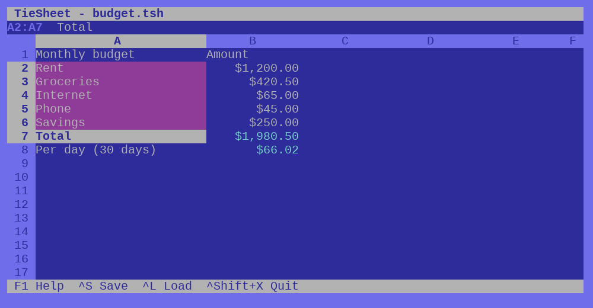
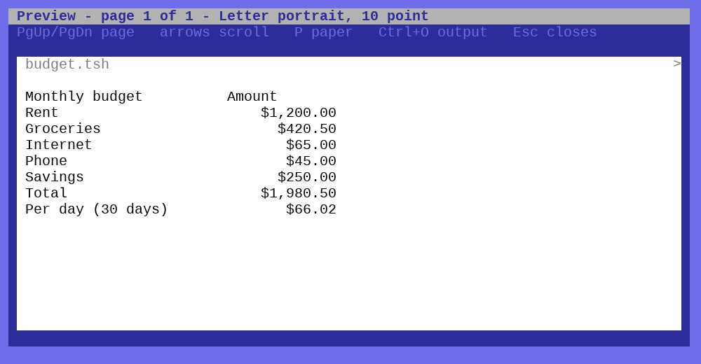
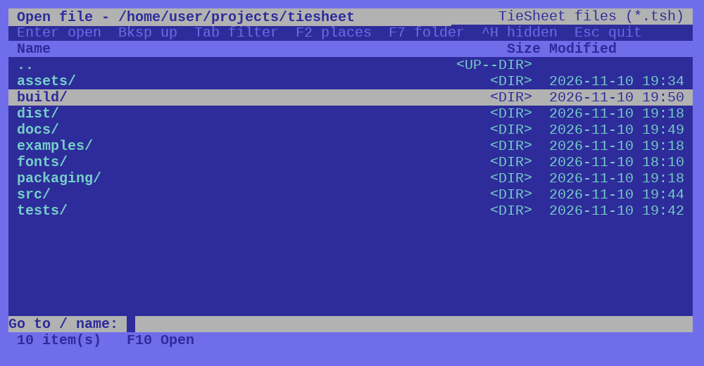

# TieSheet

A small spreadsheet for money, lists and schedules, driven entirely from the keyboard. It looks and
behaves like its sibling [TiePaper](https://github.com/zead73/tiepaper): a character-cell screen in a
coloured border, the same Ctrl-tap trick, plain-text files.



It is deliberately small. There are no charts, pivot tables or conditional formats; for those, use
LibreOffice. What it does, it tries to do carefully:

- **Exact decimals.** `0.1 + 0.2` is `0.3`, `1/3*3=1` is TRUE, and money adds up to the cent.
- **The formulas you expect**, about 50 functions (below), `$A$1` references, ranges, error values.
- **Dates as dates**: `2026-11-10`, `TODAY()`, `DATEDIF`, `WEEKDAY`, and subtracting two dates gives days.
- **Plain text everywhere.** A sheet is a `.tsh` file you can read and diff; CSV in and out, with the
  formulas kept or only the results (for sharing).
- **Keyboard first.** Every command has a key; the mouse is optional. Hold Ctrl and press a key, *or*
  tap Ctrl and then the key.

| | |
|---|---|
|  |  |

## Status

Version 0.1.0: it works and has a thorough test suite, but it is young. Tested on Linux (Arch) and,
headless under wine, on Windows. Not yet tried on a real Windows machine.

## Using it

Press **F1** in the program for the key list; the same table is in [docs/keys.md](docs/keys.md).
The essentials:

| Keys | Action |
|------|--------|
| arrows, Ctrl+arrows | Move; jump to the edge of a block |
| type, F2 | Enter into a cell; edit what is there |
| Enter, Tab | Finish and move down / right |
| Shift+arrows | Select; the status line shows the sum of a selection |
| Alt+C, Alt+X, Alt+V | Copy / cut / paste (system clipboard; formulas keep working) |
| Ctrl+D, Ctrl+R | Fill down / right |
| Ctrl+Z, Ctrl+Shift+Z | Undo / redo |
| Ctrl++, Ctrl+- | Insert / delete rows (after Ctrl+Space: columns); formulas follow |
| F3, F4, F5 | Column width, number format, sort |
| Ctrl+L, Ctrl+S | Open (file picker), save |
| Ctrl+V, Ctrl+O | Print preview, output as PDF or text |

### What typing means

`12.50` stays `12.50`; `$1,234.50` is money; `5%` is a percentage; `2026-11-10` is a date; `(5)` is minus
five; `8/1/2026` is a date typed month first, kept as `2026-08-01`; `=SUM(B2:B9)` is a formula; `'007` is text. A column can have its own format (select it with
Ctrl+Space, then F4), which numbers typed into it afterwards take.

### Functions

SUM AVERAGE MIN MAX COUNT COUNTA PRODUCT, ABS ROUND ROUNDUP ROUNDDOWN INT MOD POWER SQRT,
IF AND OR NOT IFERROR, SUMIF COUNTIF AVERAGEIF, LEN LEFT RIGHT MID UPPER LOWER TRIM CONCAT VALUE,
DATE YEAR MONTH DAY WEEKDAY TODAY DAYS EDATE DATEDIF, ISBLANK ISNUMBER ISTEXT ISERROR.

Where behaviour was in doubt it was checked against LibreOffice Calc (`tests/oracle/`), and dates
use the same serial numbers (serial 0 is 1899-12-30).

## Files

A **`.tsh`** file is plain text: a few header lines for what a CSV cannot hold, a `---` line, then the
cells as CSV exactly as typed.

```
tiesheet 1
width A 24
colformat B currency 2 1
---
Monthly budget,Amount
Rent,1200
Total,=SUM(B2:B6)
```

A **CSV** is read and written as such. A field starting with `=` is a formula, so a CSV saved from
LibreOffice with its formulas comes back as it was; whole numbers with leading zeros (`007`) stay text.
When you save a CSV you choose formulas as typed, or results only. Saving always keeps the previous
version as `name.bak`. Examples are in [examples/](examples/).

Convert without a window: `tiesheet --convert in.csv out.tsh` (add `--values` for a results-only CSV).

## Building

Needs [Free Pascal](https://www.freepascal.org/) 3.2.2 and the SDL2 and SDL2_ttf libraries (they are
loaded at run time, so nothing is linked against them).

```
./build.sh                    # build/tiesheet
./install-desktop.sh          # adds it to your application menu (and --uninstall)
./build-windows.sh            # build/win/tiesheet.exe; ./fetch-windows-dlls.sh adds the SDL2 DLLs
./make-appimage.sh            # dist/tiesheet-x86_64.AppImage (needs docker)
./make-installer.sh           # dist/tiesheet-setup.exe (needs makensis)
```

## Tests

```
tests/run-tests.sh [win]      # the engine: decimals, formulas, recalculation, files, printing (1097 checks)
tests/run-gui-tests.sh [win]  # the real program driven by scripted keystrokes, headless
```

`win` cross-compiles and runs under wine. The scripts in `tests/scripts` show every command in use.

## How it is put together

`src/tsdec.pas` exact decimals · `tsvalue`, `tsdate` · `tsformula` parser and functions ·
`tssheet` cells, recalculation, rows and columns, sorting · `tscsv`, `tsfile` files · `tsprint` pages and
PDF · `tsdirs` folders for the picker · `tsapp*.inc` the screen · `tsgfx`, `tssdl` display (shared with
TiePaper). Recalculation walks the dependencies with an explicit stack, so a 20,000-row running balance
is fine, and a loop shows `#CIRC!`.

## Licence

MIT, see [LICENSE](LICENSE). The bundled font, Liberation Mono, is under the SIL Open Font Licence
(`fonts/LICENSE-Liberation.txt`); the licences of SDL2, SDL2_ttf and FreeType are in `assets/licenses/`.
